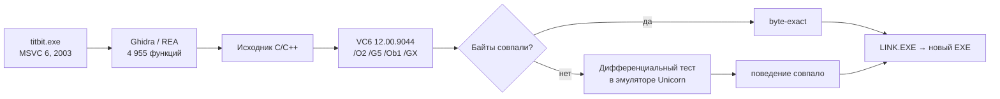

<h1 align="center">Ядерный Титбит — Decompiled</h1>

<p align="center"><b>Декомпиляция PC-версии. Исходный код C/C++ для Visual C++ 6.0, сборка под Windows 10/11.</b></p>
<p align="center">VZlab · Бука · 2003</p>
<p align="center"><a href="#как-играть">Как играть</a> · <a href="#titbit-studio">Titbit Studio</a> · <a href="#как-это-сделано">Как это сделано</a> · <a href="#результат">Результат</a></p>


Исходный код восстановлен по оригинальному `titbit.exe`: 4 955 функций, 786 481 байт
машинного кода. Каждая функция собрана тем же компилятором и сверена с оригиналом — побайтно
или по поведению. Итоговый EXE линкуется только из этих исходников.

Совместимость с Windows 10/11 вынесена в `src/compat/` (`TITBIT_COMPAT`): полный экран
без смены видеорежима, видео без внешних кодеков, запуск без диска. Игровая логика не изменена.

> [!IMPORTANT]
> **Для игры нужна ваша копия «Ядерного Титбита»** — оригинальный CD, образ диска
> (ISO / IMG / CUE / CCD) или установленная игра. Уровни, модели, музыка, озвучка и видео
> берутся оттуда: в репозиторий и готовые сборки они **не входят**.

## Как играть

1. Скачайте `TitbitModern-*-windows-x64.zip` из [Releases](https://github.com/offx366/titbit-modern/releases/latest) и распакуйте.
2. Запустите **TitbitSetup.exe** и укажите свой диск, образ или папку установленной игры.
3. Играйте — **TitbitModern.exe** (настройки экрана — **TitbitSettings.exe**).

**TitbitSetup** сам достаёт данные игры: читает CD и образы напрямую, без монтирования
и без запуска старого установщика (распаковывает его архивы InstallShield 6), находит
`QUEST.ezd` и 18 роликов в установленной игре и проверяет все 19 файлов по SHA-256.
После импорта диск больше не нужен. Подробно: [docs/GETTING_STARTED.md](docs/GETTING_STARTED.md).

## Titbit Studio

Редактор сцен. **TitbitStudio.exe** открывает в браузере все 70 локаций: свободная камера, выбор и перемещение объектов, кости, материалы, скрипты,
родные EZA-анимации, экспорт в Blender (OBJ / GLB) и импорт обратно, сборка мода в новый
`QUEST.ezd`. Форматы XML-сцен, MEAT-моделей, MAT-материалов и EZA-анимаций
восстановлены по коду движка.


Руководство: [editor/README.md](editor/README.md).

## Как это сделано



- **Исходный тулчейн.** По Rich-заголовку оригинала определён компилятор — Visual C++ 6.0,
  сборка 12.00.9044 — и флаги. Каждая функция компилируется, линкуется по адресу оригинала
  и сравнивается побайтно.
- **Опознаны библиотеки:** SeeR 0.94a (скриптовый движок), IJG JPEG 6a, zlib 1.1.3, Audiere,
  Ogg Vorbis, WTL, CenterPoint XML, рантайм VC6.
- **Дифференциальное тестирование.** То, что не совпало побайтно, запускалось бок о бок
  с оригиналом в эмуляторе x86 на тысячах одинаковых случайных входов: сравнивались вызовы,
  записи в память, стек и возвращаемое значение. Найденные этим ошибки декомпиляции исправлены:
  порядок умножения кватернионов костей, use-after-free в строках,
  загрузка текстур, выход за буфер на один байт.
- **Функции вне анализа Ghidra.** 146 функций, которые Ghidra не распознала (вызываются только через
  таблицы виртуальных методов), найдены по ссылкам из vtable и восстановлены.
- **Lockstep.** Сборка из исходников и оригинальный код прогонялись кадр в кадр
  на записанных сессиях: 21 291 кадр без расхождений.

## Результат

| Метрика | Значение |
|---|---|
| Функций | **4 955 / 4 955** |
| Машинного кода покрыто исходниками | **786 481 из 786 481 байт — 100 %** |
| Совпадает с оригиналом **байт в байт** | **633 954 байт — 80,6 %** (4 437 функций) |
| Остальное — поведение подтверждено | **152 527 байт — 19,4 %** (тесты в эмуляторе + разбор вручную) |
| Функций с отличающимся поведением | **0** |
| Байтов оригинального EXE в сборке | **0** |

```
байт в байт          ████████████████████████████████████████░░░░░░░░░░  80,6 %
поведение совпадает  ██████████████████████████████████████████████████ 100,0 %
```

Расхождения в оставшихся 19,4 % — распределение регистров и решения компилятора об инлайне;
логика совпадает. Побайтное совпадение продолжается в отдельном проекте декомпиляции.

## Сборка из исходников

Нужны Python 3.11 и своя установка **Visual C++ 6.0 SP6** (с MASM) + Resource Compiler
из Windows SDK. Инструменты Microsoft в репозиторий не входят.

```powershell
$env:TITBIT_VC6 = 'C:\Program Files (x86)\Microsoft Visual Studio\VC98'
py -3.11 -m venv .venv
.\.venv\Scripts\python.exe -m pip install -r requirements.txt
.\.venv\Scripts\python.exe tools/build_modern.py --fresh
```

Готовые EXE — в `build/modern/`. Версия без слоя совместимости, Studio, portable-пакет:
[docs/BUILD.md](docs/BUILD.md).

| Папка | Что внутри |
|---|---|
| `src/native`, `src/lanes` | движок игры |
| `src/compat` | слой совместимости с современными Windows |
| `editor` | Titbit Studio |
| `tools`, `config` | сборка и импорт данных |

---

Проверено: сборка из этого репозитория, импорт данных с образа диска, игра от меню до первой
улицы. Полное прохождение и все сочетания Windows/видеокарт ещё не проверены — пишите в Issues.
[Подробности проверок](docs/VALIDATION.md).

Игра и её материалы — © VZlab / Бука. Данные игры, образы диска и инструменты Microsoft
не распространяются. [Сторонние библиотеки](THIRD_PARTY_NOTICES.md) · [Данные игры](docs/ASSETS.md)
