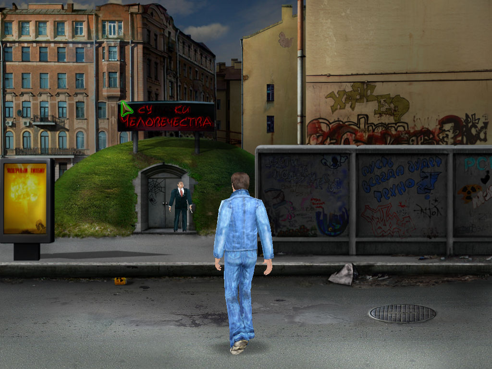
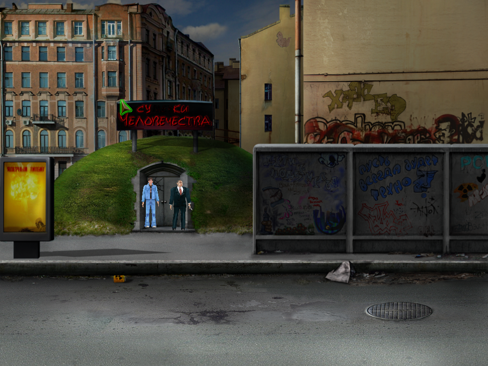
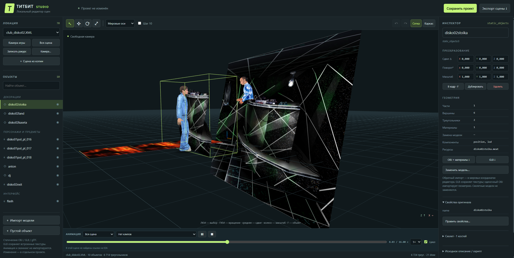
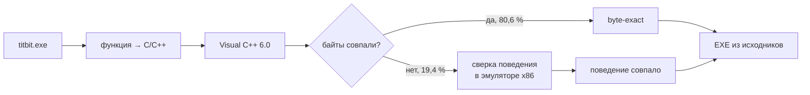

<h1 align="center">Ядерный Титбит</h1>

<p align="center"><b>Восстановленные исходники игры. Windows 10/11 и нативный Linux-порт.</b></p>
<p align="center">VZlab · Бука · 2003</p>



Код игры восстановлен по оригинальному `titbit.exe`. Сборка Windows работает на
Windows 10/11; Linux-порт собирается в нативный ELF32 и использует SDL2, OpenGL и FFmpeg.
Для современных Windows добавлены полный экран
(**Alt+Enter / F11**), воспроизведение видео без старых кодеков и запуск без диска.

> [!IMPORTANT]
> **Для игры нужна ваша копия «Ядерного Титбита»** — оригинальный CD, образ диска
> (ISO / IMG / CUE / CCD) или установленная игра. Уровни, модели, музыка, озвучка и видео
> берутся оттуда: в репозиторий и готовые сборки они **не входят**.

<details>
<summary>Где взять данные игры?</summary>

Используйте свою копию оригинального диска или установленной игры. Мастер импорта
читает образы и установочные файлы напрямую; запускать старый установщик не требуется.

</details>

## Установка Windows

1. Скачайте `TitbitModern-*-windows-x64.zip` из [Releases](https://github.com/offx366/titbit-modern/releases)
   и распакуйте в любую папку, например `C:\Games\TitbitModern`.
2. Запустите **TitbitSetup.exe** и укажите, откуда взять данные игры:
   - **диск** — вставьте CD и выберите привод;
   - **образ** — выберите файл ISO, IMG, CUE или CCD (монтировать не нужно);
   - **установленная игра** — выберите её папку.

   Нажмите **«Добавить файлы игры»**. Программа сама найдёт и скопирует `QUEST.ezd`
   и 18 видеороликов и проверит их. Старый установщик запускать не нужно.
3. Запустите **TitbitModern.exe** — игра. **TitbitSettings.exe** — размер окна,
   полный экран, пропорции 4:3 или растяжение.

После импорта диск больше не нужен. Python, компилятор и интернет не требуются.
Если что-то не получилось: [docs/GETTING_STARTED.md](docs/GETTING_STARTED.md).

## Установка Linux

Проверено на **Ubuntu 24.04 x86-64** и WSL2 / WSLg. Игра — **ELF32/i386**:
нужны 32-битные библиотеки, Wine не используется. ARM64 и другие дистрибутивы
пока не проверены. Для запуска готового пакета компилятор и VC98 не нужны.

1. Установите зависимости:

   ```bash
   sudo dpkg --add-architecture i386
   sudo apt update
   sudo apt install libc6:i386 libstdc++6:i386 libsdl2-2.0-0:i386 \
     libgl1:i386 libglu1-mesa:i386 libavformat60:i386 libavcodec60:i386 \
     libavutil58:i386 libswscale7:i386 libswresample4:i386 zlib1g:i386 \
     python3 python3-tk python3-pil
   ```

2. Скачайте `Titbit-0.2.0-linux.1-linux-x86.tar.gz` из
   [Linux Release](https://github.com/offx366/titbit-modern/releases/tag/v0.2.0-linux.1),
   распакуйте и перейдите в каталог пакета:

   ```bash
   tar -xzf Titbit-0.2.0-linux.1-linux-x86.tar.gz
   cd Titbit-0.2.0-linux.1-linux-x86
   sh tools/import_assets.sh
   ```

   Выберите ISO / IMG / CUE / CCD, папку оригинального InstallShield-установщика
   (`data1.hdr`, `data*.cab`) или готовую папку игры. Мастер извлечёт `QUEST.ezd`
   и 18 AVI, проверит SHA256 и сохранит их в `~/.local/share/titbit/game/`.
   Произвольные однофайловые репаки `setup.exe` не поддерживаются.

3. Запустите игру или Studio:

   ```bash
   sh start-game.sh
   sh tools/start_studio.sh
   ```

Studio откроется в браузере по `http://127.0.0.1:4318/`. Игровые данные
не изменяются; проекты хранятся в `~/.local/share/titbit/studio-projects/`.
Для сервера без браузера: `sh tools/start_studio.sh --no-browser`.

Консольный импорт и другая папка данных:

```bash
sh tools/import_assets.sh --import /path/to/game.iso --dest "$HOME/Games/Titbit-data"
sh start-game.sh --data "$HOME/Games/Titbit-data"
sh tools/start_studio.sh --archive "$HOME/Games/Titbit-data/QUEST.ezd"
```

Linux-порт находится в [`linux-port/`](linux-port/). Инструкции:
[сборка](linux-port/docs/BUILD-LINUX.md), [импорт и Studio](linux-port/docs/STUDIO.md).
В Linux проверены ролики, меню, начальная улица, ходьба, анимации, диалог,
сохранение и загрузка. Полное прохождение пока не проверено. Полный экран
Alt+Enter / F11 и Windows-панель настроек относятся к Windows-сборке.



Состав и результаты проверок: [VALIDATION-LINUX.md](docs/VALIDATION-LINUX.md).

## Titbit Studio

Редактор сцен в комплекте. В Windows запустите **TitbitStudio.exe**, в Linux —
`sh tools/start_studio.sh`. В браузере откроются все 70 локаций игры:
свободная камера, выбор и перемещение объектов, анимации, экспорт в Blender (OBJ / GLB)
и обратно, сборка своего мода. Файлы игры при этом не меняются.



Управление: [editor/README.md](editor/README.md).

## Насколько это оригинал

Каждая из **4 955** функций игры переписана на C/C++, собрана тем же компилятором, что и
в 2003 году (Visual C++ 6.0), и сверена с оригинальным EXE.

| | Байт кода | |
|---|---|---|
| Совпадает с оригиналом **байт в байт** | 633 954 | **80,6 %** |
| Поведение совпадает, байты отличаются | 152 527 | **19,4 %** |
| **Итого соответствует оригиналу** | **786 481** | **100 %** |

```
байт в байт   ████████████████████████████████████████░░░░░░░░░░   80,6 %
поведение     ██████████████████████████████████████████████████  100,0 %
```



## Сборка из исходников

**Linux:** [Clang/LLVM, ELF32 и Microsoft object ABI](linux-port/docs/BUILD-LINUX.md).
Заголовки VC98 нужны только при сборке; Windows CRT `.lib` в Linux не линкуются.

**Windows:**

Нужны Python 3.11 и своя установка **Visual C++ 6.0 SP6** с MASM и Resource Compiler из Windows SDK
(инструменты Microsoft в репозиторий не входят).

```powershell
git clone https://github.com/offx366/titbit-modern.git
cd titbit-modern
$env:TITBIT_VC6 = 'C:\Program Files (x86)\Microsoft Visual Studio\VC98'
py -3.11 -m venv .venv
.\.venv\Scripts\python.exe -m pip install -r requirements.txt
.\.venv\Scripts\python.exe tools/build_modern.py --fresh
```

Готовые EXE появятся в `build/modern/`. Подробнее — [docs/BUILD.md](docs/BUILD.md).

---

Проверено: сборка из этого репозитория, импорт с образа диска, игра от меню до первой улицы.
Полное прохождение и разные видеокарты ещё не проверены — пишите о проблемах в Issues.

Игра и её материалы — © VZlab / Бука. Данные игры и инструменты Microsoft не распространяются.
[Сторонние библиотеки](THIRD_PARTY_NOTICES.md) · [Данные игры](docs/ASSETS.md)
