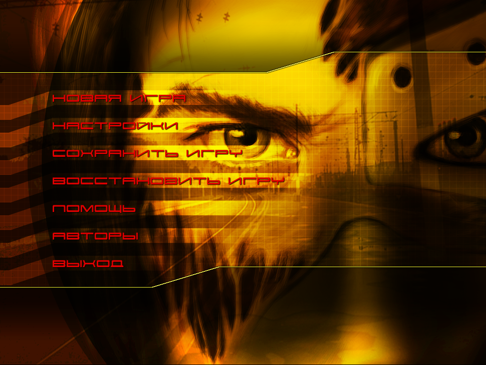

# Titbit Modern — Ядерный Титбит

Восстановленные исходники **«Ядерного Титбита»** (VZlab / Бука, 2003), сборка
для современных Windows и **Титбит Studio** — локальный веб-редактор сцен.
Неофициальный проект исследования и восстановления игры.

Это рабочая реконструкция оригинальной игры с отдельным слоем совместимости.
EXE собирается из C/C++ и ассемблерных исходников без копирования машинного кода
или данных из оригинального `titbit.exe`. CRT/STL линкуются из установленного VC6.
Архив QUEST.ezd, видеоролики и инструменты Microsoft в репозиторий не входят.


## Современная версия игры

- Полноэкранный режим в разрешении монитора без смены видеорежима.
  **Alt+Enter / F11** переключают окно и полный экран.
- Выбор размера окна, пропорции **4:3** или растяжение, преобразование координат
  мыши с учётом масштаба окна и DPI. 3D-сцена рендерится в новом viewport;
  координаты сцены и интерфейса остаются 1024×768, детализация текстур не меняется.
- **TitbitSettings.exe** — режим экрана, размер окна, пропорции и запуск игры.
  Громкость регулируется в меню самой игры.
- Запуск со своей локальной копией данных без диска в приводе.
- Совместимость со звуком и воспроизведением старых видео: MP42 через Windows
  Media Foundation, CRAM — собственный декодер, без установки старого codec pack.

Дополнения находятся в `src/compat/` и включаются через **TITBIT_COMPAT**.
Цель основного движка — сохранить игровую логику и поведение оригинала.
`tools/build_original.py` собирает вариант без слоя совместимости.



## Титбит Studio — редактор сцен в браузере

Studio открывает исходный `QUEST.ezd` и показывает **70 игровых локаций**.
Сервер работает локально, интерфейс открывается на **http://127.0.0.1:4318/**.
Three.js включён в репозиторий, подключение к интернету не требуется.


В редакторе доступны:

- Исходная игровая камера **4:3** и свободный обзор всей сцены.
- Дерево объектов, выбор мышью, рамка выделения в обоих режимах камеры.
- Перемещение, поворот, масштаб, числовые поля, локальные/мировые оси и привязка.
- Геометрия, материалы, кости, исходные свойства, XML и просмотр скриптов.
- Предпросмотр родных **EZA-анимаций**: вся сцена или выбранный объект,
  воспроизведение, пауза, перемотка, скорость и цикл; предпросмотр теней и частиц.
- Экспорт **OBJ + MTL + PNG** или **GLB**, статический импорт OBJ/GLB/glTF,
  замена модели с сохранением имени, свойств и скрипта объекта.
- Дублирование, удаление и создание объектов, копии локаций, редактирование камеры,
  отмена/повтор, сохранение отдельного проекта и экспорт изменённого `QUEST.ezd`.

Часть оригинальных декораций — плоские поверхности с заранее нарисованным фоном;
свободная камера показывает их реальное устройство. Редактор не исполняет
квестовую VM, диалоги и сохранённое состояние прохождения. AVI и часть родных
эффектов света в предпросмотре не воспроизводятся. FBX и импорт анимированных
моделей не поддерживаются; GLB экспортирует текущую статическую позу.

Исходный архив открывается **только для чтения**. Изменения хранятся отдельно,
готовый мод скачивается в ZIP. Подробности и управление — [editor/README.md](editor/README.md).

## Быстрый старт

Нужны Windows 10/11, **Python 3.11**, собственная установка **Visual C++ 6.0 SP6**
с MASM и Resource Compiler из Windows SDK. Полный список — [docs/BUILD.md](docs/BUILD.md).

```powershell
git clone https://github.com/offx366/titbit-modern.git
cd titbit-modern
py -3.11 -m venv .venv
.\.venv\Scripts\python.exe -m pip install -r requirements.txt
$env:TITBIT_VC6 = 'C:\Program Files (x86)\Microsoft Visual Studio\VC98'
.\.venv\Scripts\python.exe tools/build_modern.py --check
.\.venv\Scripts\python.exe tools/build_modern.py --fresh
```

Результат: `build/modern/TitbitModern.exe` и `TitbitSettings.exe`.
Для игры положите рядом **QUEST.ezd** и **18 роликов AVI** из своей копии игры.
Запускайте игру из этой папки напрямую или через `TitbitSettings.exe`.
Сохранения из другой папки автоматически не копируются.

Редактор можно использовать независимо от сборки EXE. После установки Python-зависимостей:

```powershell
.\.venv\Scripts\python.exe editor/server.py --archive 'D:\Games\Titbit\QUEST.ezd'
```

Откройте **http://127.0.0.1:4318/**. Для другого порта добавьте `--port 4319`.

## Что проверено

Публичное дерево исходников собрано с `TITBIT_VC6` отдельно от исследовательской
папки, без исходников CRT/OpenNT и оригинального EXE. Проверенная современная
сборка проходит **меню → новая игра → интро → первая улица** и принимает клики
по земле. Тесты редактора проверяют все исходные 314 MEAT, 161 MAT, 70 XML
и 455 EZA, импорт/экспорт и повторное открытие архива мода.

Это не побайтно идентичный дисковому EXE и не проверка полного прохождения либо
всех версий Windows/GPU. Проверенные условия, хеши сборок и ограничения —
[docs/VALIDATION.md](docs/VALIDATION.md).

## Устройство репозитория

| Каталог | Содержимое |
|---|---|
| `src/native`, `src/lanes/*` | восстановленный движок, рендер, ввод, звук, XML и игровые API |
| `src/scripts`, `src/script_headers` | скрипты квестов и заголовки SeeR |
| `src/seer`, `src/jpeg`, `src/audiere`, `third_party` | библиотеки со своими лицензиями |
| `src/compat` | совместимость с современными Windows, экран, видео, звук и лаунчер |
| `editor` | локальный сервер Studio, парсеры форматов и Three.js-интерфейс |
| `tools`, `config/source-build.json` | сборка из исходников и переносимые метаданные связывания |
| `docs` | инструкции, сведения о проверках, лицензии и скриншоты |

Многие имена функций сохраняют адрес в оригинале для сопоставления при исследовании.
Восстановление побайтно идентичного оригинала — отдельное направление;
этот репозиторий предназначен для рабочей версии и дальнейших модификаций.

## Участие

В отчёте об ошибке укажите версию Windows, видеокарту, коммит сборки, локацию
и шаги воспроизведения. Прикладывайте журнал или скриншот; игровые архивы,
видео, установщики и инструменты Microsoft в issues и pull requests не загружайте.
Совместимость меняется в `src/compat`, исходная логика — только при подтверждённом
расхождении с оригиналом.

Работа с оригинальными ресурсами и варианты сохранения контента —
[docs/ASSETS.md](docs/ASSETS.md).

## Права и лицензии

Права на оригинальную игру, её графику, звук, тексты и другие материалы
принадлежат их правообладателям. Проект не является официальным релизом
и не предоставляет лицензию на эти материалы. Общая MIT/GPL-лицензия всему
репозиторию не назначена. Условия сторонних компонентов —
[THIRD_PARTY_NOTICES.md](THIRD_PARTY_NOTICES.md).

Игровые архивы, видео, оригинальные EXE, образ диска, исходники CRT/STL,
компилятор и SDK Microsoft в репозиторий не включены. Для запуска нужна своя
копия игровых данных. Скриншоты демонстрируют игру и редактор.
